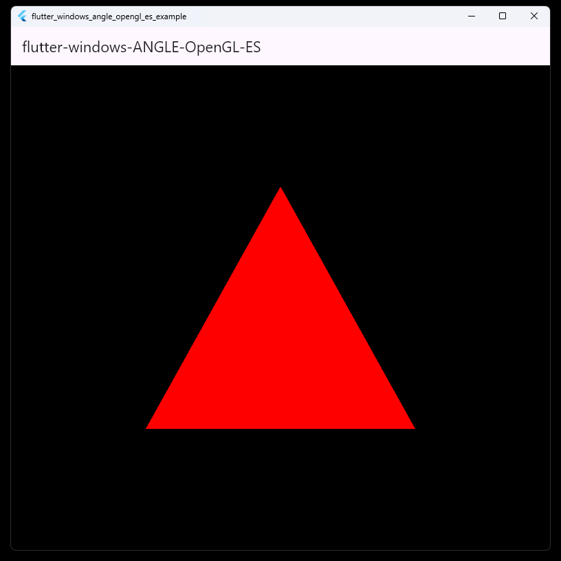

# flutter-windows-ANGLE-OpenGL-ES

OpenGL ES hardware accelerated rendering on Flutter Windows `Texture` Widget using ANGLE.



## Introduction

[ANGLE (Almost Native Graphics Layer Engine)](https://github.com/google/angle) is used in this example, which translates these OpenGL ES calls to DirectX 11 (which Flutter Windows now supports) calls internally. The example uses the [new Direct3D texture interop capability for Flutter Windows](https://github.com/flutter/engine/pull/26840) added by [@jnschulze](https://github.com/jnschulze).

Prebuilt ANGLE DLLs and import libraries for x64 and ARM64 are in [windows/bin](windows/bin). The build uses `chromium/8078`; source revisions are pinned in [config/angle.lock.json](config/angle.lock.json). D3D11 (feature levels 10_0–12_1, with WARP fallback), desktop OpenGL, native OpenGL ES, Vulkan, and SwiftShader are enabled.

## Notes

Use Flutter `3.47.x` with its bundled Dart `3.13.x` SDK.

## Run

```bash
cd example
flutter run -d windows
```

## Build ANGLE

Requires Visual Studio C++ tools, Windows SDK `10.0.28000.x`, Git, Python 3.12 or later, and 7-Zip.

```cmd
python scripts\windows\angle.py setup
python scripts\windows\angle.py build x64
python scripts\windows\angle.py install x64
python scripts\windows\angle.py package x64
```

Use `arm64` instead of `x64` for ARM64. [Release v8078](https://github.com/Carapacik/flutter-windows-ANGLE-OpenGL-ES/releases/tag/v8078) provides `ANGLE-9fe55a5-windows-x64.7z`, `ANGLE-9fe55a5-windows-arm64.7z`, and `SHA256SUMS`.

## Acknowlegements

- [@jnschulze](https://github.com/jnschulze) for working on [Windows: Add Direct3D texture interoperability support](https://github.com/flutter/engine/pull/26840) in [flutter/engine](https://github.com/flutter/engine).
- [@clarkezone](https://github.com/clarkezone) for awesome ANGLE + Windows article at [A common OpenGL renderer for UWP and Win32 using ANGLE and Win.UI.Composition](https://clarkezone.github.io/angle/2020/02/24/angle.html).
- [media-kit](https://github.com/media-kit/media-kit) for the Windows shared-texture implementation.

## References

- [Example project showing usage of ANGLE on Windows from @clarkezone](https://github.com/clarkezone/anglehosting).
- [Interop-with-other-DirectX-code section in Microsoft's ANGLE repository](https://github.com/Microsoft/angle/wiki/Interop-with-other-DirectX-code).
- [HelloTriangle.cpp from ANGLE repository](https://github.com/google/angle/blob/main/samples/hello_triangle/HelloTriangle.cpp).
